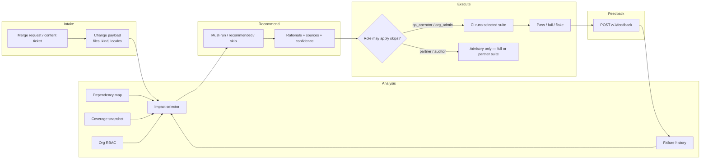

# Field workflow map

How a portal QA team uses Mithuna from a merge request to the next model refresh.

## Production swimlane

| Step | Who | System | Notes |
| --- | --- | --- | --- |
| 1. Intake | Developer or content editor | Git / CMS | Code diffs and `locales/*/`.json publish events both become `ChangedFile` rows. Content tickets often have **no** Python files. |
| 2. Identity | CI or QA console | Headers | `X-Org-Id` + `X-Role` bound the catalog. A NID partner never sees internal payment tests. |
| 3. Source gather | Platform | Warehouses | Each source has an SLA. Selector records `available` / `delayed` / `missing` instead of blocking the pipeline. |
| 4. Impact analysis | Selector | `select_tests` | Blast radius = files ∪ dependents ∪ coverage ∪ locale rules. |
| 5. Recommendation | QA lead | API / CLI | Skip list is explained per test. Threshold is printed so operators can challenge it. |
| 6. Execution | CI | pytest / Playwright shards | `must_run` is gating. `recommended` can be a non-gating shard if policy allows. |
| 7. Feedback | CI | `/v1/feedback` | Failures on skipped tests (should be rare) are incidents; correlated files feed history. |
| 8. Tune | Platform | Weekly | Adjust threshold only with experiment notebook recall still at 1.0. |

## Two intake shapes

**Code change** (auth session expiry): expand `src/auth/session.py` to OTP, profile, benefits application. Keep security + smoke even if coverage is stale.

**Language content change** (Hindi benefits copy): keep `test_locale_hi_*` and Hindi benefits E2E. Skip Tamil/Bengali copy tests. Do **not** skip `test_i18n_fallback` if the change also touches formatter/fallback code; content-only Hindi does skip unrelated locale E2E but still keeps tagged smoke/auth.

## Operational SLOs (prototype defaults)

| Signal | Fresh | Degraded behavior |
| --- | --- | --- |
| Change payload | Required for skips | No files → run all |
| Coverage | < 24h | `stale` / delayed → higher skip threshold |
| Dependencies | On merge of module graph | Missing → coverage + patterns only |
| Failure history | Nightly | Missing → skip still allowed but slightly harder |

Wall-clock: selection is local JSON, typically well under 100 ms for ~50 tests. Suite time savings come from **not launching** skipped E2E jobs, not from the API itself.
